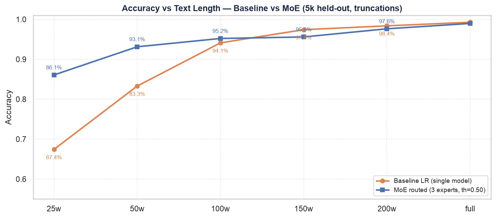
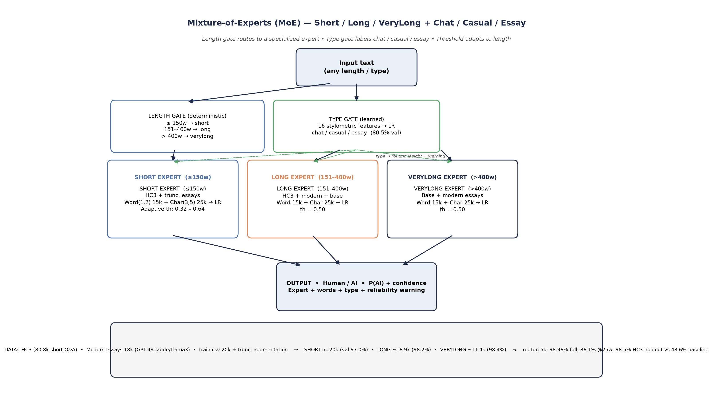

<!--
  Classification of Human-Written and AI-Generated Text — NIT Sikkim
  Live: https://pravesh34.github.io/AI_generated_text_classification/
  API:  https://moe-text-classifier-pravesh12.vercel.app
-->

<div align="center">

# 🔎 Classification of Human-Written and AI-Generated Text

### A length-gated Mixture-of-Experts classifier

**NIT Sikkim · Department of Computer Science & Engineering**
Pravesh Gedon Sharma (B240019) · Ankit Rawat (B320032) · Course Project 2026

[](https://pravesh34.github.io/AI_generated_text_classification/) [](https://moe-text-classifier-pravesh12.vercel.app) [](https://python.org) [](https://scikit-learn.org) [](app/app.py)

**Detecting AI-generated text is easy on full essays — and hard where it matters: short inputs.**

Our Mixture-of-Experts router takes the same baseline that collapses on short text and lifts it
from **67.4% → 86.1% at 25 words** and **48.6% → 98.5% on unseen chat**, while holding **98.96%** on full essays.

</div>

<a href="https://pravesh34.github.io/AI_generated_text_classification/#live">
  
</a>

<p align="center"><sub>Live inference on the project site — the model runs server-side from the tracked <code>.pkl</code> artifacts.</sub></p>

---

## 📑 Contents

- [Why this project](#-why-this-project)
- [Results](#-results)
- [Architecture](#-architecture)
- [Live demo & API](#-live-demo--api)
- [Quickstart](#-quickstart)
- [Reproduce the MoE upgrade](#-reproduce-the-moe-upgrade)
- [Reports & papers](#-reports--papers)
- [Project structure](#-project-structure)
- [Data & models](#-data--models)
- [Limitations](#-limitations)

---

## 💡 Why this project

Most detectors report a single accuracy on long essays. Real usage looks different: a chat reply, a
short answer, the first paragraph of a submission. On those inputs, a global model trained on
400-word essays has almost no signal — and it systematically labels human writing as AI.

We measured the cliff, then fixed it:

| Phase | Contribution |
|---|---|
| **1 · Classical ML** | 24 stylometric features (TTR, hapax ratio, burstiness, readability, punctuation), word + char TF-IDF, Sentence-BERT; Logistic Regression, Linear SVM, Random Forest |
| **2 · Transformers** | DistilBERT / RoBERTa fine-tuning with chunking for long documents |
| **3 · Evaluation** | Accuracy, precision, recall, F1, ROC-AUC, confusion matrices, feature-family ablation |
| **4 · MoE upgrade** | Length-gated experts trained on short chat + modern-LLM essays + truncation augmentation, with a text-type gate and length-adaptive thresholds |

The result is not just a higher average — it is a model that stays usable at 25 words, where the
baseline is close to a coin flip.

---

## 📊 Results

<p align="center">
  
</p>

**At a glance**

| 98.96% | 86.06% | 98.52% | 80.5% |
|:---:|:---:|:---:|:---:|
| full essays | first 25 words | unseen HC3 chat | chat / casual / essay gate |

### Headline comparison

5k held-out essays. Source: [`results/moe_baseline_comparison.csv`](results/moe_baseline_comparison.csv),
[`results/moe_routed_metrics.csv`](results/moe_routed_metrics.csv).

| Condition | Baseline | MoE routed | Δ |
|---|---:|---:|---:|
| Full text | **99.26%** | 98.96% | −0.3 |
| First 200 words | 98.36% | 97.62% | −0.7 |
| First 150 words | 97.40% | 95.58% | −1.8 |
| First 100 words | 94.10% | 95.20% | **+1.1** |
| First 50 words | 83.28% | **93.12%** | **+9.8** |
| First 25 words | 67.42% | **86.06%** | **+18.6** |
| First 3 sentences | — | 93.36% | — |
| First 2 sentences | — | 90.56% | — |
| First 1 sentence | 59.82% | **81.64%** | **+21.8** |
| HC3 holdout (unseen chat domain) | 48.56% | **98.52%** | **+49.9** |
| Modern holdout (GPT-4 / Claude) | 85.52% | **95.70%** | **+10.2** |

The MoE deliberately trades a fraction of a point on full essays (already near ceiling) for a
large gain wherever the baseline actually fails.

### Per-expert validation

| Expert | Words | Val accuracy | F1 | ROC-AUC |
|---|---|---:|---:|---:|
| `short` | ≤ 150 | 97.00% | 0.970 | 0.996 |
| `long` | 151–400 | 98.19% | 0.983 | 0.998 |
| `verylong` | > 400 | 98.42% | 0.982 | 0.996 |

Type gate (**chat / casual / essay**) accuracy: **80.5%**. Raw metrics:
[`results/moe_summary.json`](results/moe_summary.json),
[`results/moe_expert_metrics.csv`](results/moe_expert_metrics.csv).

---

## 🧩 Architecture

```text
                          text
                           │
              length gate (word count, deterministic)
              ├── ≤ 150 words  → expert_short    (HC3 chat + truncated essays)
              ├── 151–400      → expert_long     (HC3 long + modern long + essays)
              └── > 400        → expert_verylong (essays + modern long-form)
                           │
        each expert = Word TF-IDF (1–2 gram, 15k)
                    + Char TF-IDF (3–5 gram, 25k)
                    + Logistic Regression (C = 1.5)
                           │
        type gate (LR on 16 stylometric features) → chat / casual / essay
        length-adaptive threshold (short: 0.32 → 0.64) + short-text warning
                           │
                    label + calibrated confidence
```

<p align="center">
  
</p>

**Why it works**

- **Domain match, not just model size.** HC3 supplies genuine short Q&A chat; truncation
  augmentation teaches the short expert what the beginning of an essay looks like.
- **A deterministic gate beats a learned one here.** Word count is cheap, stable, and matches the
  accuracy cliff observed in the ablation (~100–150 words).
- **Thresholds adapt to length.** Short text needs a lower decision threshold; long text does not.
- **Honest uncertainty.** Inputs under 25 words return a warning instead of overconfident output.

Implementation: [`moe/train_moe.py`](moe/train_moe.py) · [`moe/type_features.py`](moe/type_features.py) · [`moe/predict_moe.py`](moe/predict_moe.py) · [`moe/README.md`](moe/README.md)

---

## 🌐 Live demo & API

| | |
|---|---|
| **Website** | https://pravesh34.github.io/AI_generated_text_classification/ |
| **API base** | https://moe-text-classifier-pravesh12.vercel.app |
| **Streamlit (local)** | `streamlit run app/app.py` |

The static site runs on GitHub Pages; inference is a Python serverless function on Vercel
(`web/api/predict.py`) that loads the tracked `.pkl` artifacts and exposes CORS so the page can
call it directly.

```bash
curl -X POST "https://moe-text-classifier-pravesh12.vercel.app/api/predict" \
  -H "Content-Type: application/json" \
  -d '{"text":"I think sports are great because they keep kids busy after school"}'
```

```json
{
  "label": "Human-Written",
  "prob_ai": 0.0054,
  "prob_human": 0.9946,
  "confidence": 0.9946,
  "threshold_used": 0.32,
  "expert": "short",
  "words": 12,
  "text_type": "casual",
  "type_confidence": 0.981,
  "warning": "WARNING: <25 words - very low signal, treat as uncertain."
}
```

`GET /api/predict` returns a health check. Deployment notes: [`web/README.md`](web/README.md).

---

## 🚀 Quickstart

```bash
git clone https://github.com/pravesh34/AI_generated_text_classification.git
cd AI_generated_text_classification

python3 -m venv venv && source venv/bin/activate
pip install numpy scipy scikit-learn==1.9.1 joblib pandas streamlit
```

The models are tracked in Git (~10 MB), so **inference works immediately — no retraining**.

**Interactive demo** — MoE + baseline, live result card, figures, and reports:

```bash
streamlit run app/app.py
```

**CLI** — routes by length, labels text type, warns on short input:

```bash
PYTHONPATH=. python3 moe/predict_moe.py \
  "I think sports are great because they keep kids busy after school"
# → {"label": "Human-Written", "prob_ai": 0.0054, "expert": "short", ...}
```

**Python**:

```python
from moe.predict_moe import predict

print(predict("In today's rapidly evolving digital landscape, ..."))
```

**Full toolchain** (notebooks, FastAPI, LangChain tool, batch evaluation):

```bash
pip install -r requirements.txt "datasets>=2.16" huggingface_hub pyarrow reportlab pypdf seaborn
jupyter notebook          # notebooks/01 → 06, in order
python3 test/api.py       # FastAPI on :8001 → interactive docs at /docs
python3 test/predict.py --csv data/test.csv --model lr --sample 5000 --out test/results
```

---

## 🔁 Reproduce the MoE upgrade

The short-text datasets download automatically from Hugging Face. The large essay corpus stays
local (gitignored) — see [`data/README.md`](data/README.md).

```bash
# 1. short-text data → data/moe/ (HC3 + modern LLM essays, ~126 MB)
PYTHONPATH=. python3 moe/download_small_text.py

# 2. train 3 experts + type gate → models/moe/ (~2 minutes on a laptop)
PYTHONPATH=. python3 moe/train_moe.py

# 3. calibrate length-adaptive thresholds → models/moe/thresholds.json
PYTHONPATH=. python3 moe/calibrate_thresholds.py

# 4. regenerate figures and papers
PYTHONPATH=. python3 moe/make_moe_appendix.py
PYTHONPATH=. python3 make_research_paper.py
PYTHONPATH=. python3 make_deepseek_paper.py
cp *.pdf reports/
```

---

## 📄 Reports & papers

Everything lives in [`reports/`](reports/README.md).

| Document | What it covers |
|---|---|
| [`report.pdf`](reports/report.pdf) | Main project report (12 pages): baseline + MoE appendix |
| [`Research_Paper_MoE_AI_Text_Detection.pdf`](reports/Research_Paper_MoE_AI_Text_Detection.pdf) | 7-page paper: baseline vs MoE, short-text ablation, cross-domain results |
| [`DeepSeek_Style_Research_Paper_MoE.pdf`](reports/DeepSeek_Style_Research_Paper_MoE.pdf) | 9-page deep dive: formal method, per-length ablation, calibration |
| [`Project_Report_MoE_Appendix.pdf`](reports/Project_Report_MoE_Appendix.pdf) | Standalone 6-page MoE appendix |
| [`Code_Workflow_and_Run_Guide.pdf`](reports/Code_Workflow_and_Run_Guide.pdf) | Setup → train → test → API → UI |
| [`VIDEO_SCRIPT_MoE_20min.md`](reports/VIDEO_SCRIPT_MoE_20min.md) | 20-minute narrated walkthrough with visual cues |

---

## 🗂 Project structure

```text
├── app/app.py                  # Streamlit demo: live inference, figures, reports
├── moe/                        # MoE upgrade: download, features, train, calibrate, predict
├── src/                        # preprocessing, stylometrics, semantic features, evaluation
├── notebooks/                  # 01 EDA → 06 evaluation (Jupyter)
├── models/                     # baseline TF-IDF + LR/SVM
│   └── moe/                    # 3 experts + type gate + thresholds (~10 MB, tracked)
├── results/                    # metrics CSVs, summary JSON, figures
├── reports/                    # all PDFs + talk script + index
├── web/                        # Vercel site + serverless inference API
├── docs/                       # GitHub Pages build (site, figures, reports, assets)
├── test/                       # inference, batch CLI, FastAPI, LangChain tool
├── data/                       # large CSVs (local) + tracked samples + catalogue
└── train_baseline.py · run_all.sh · requirements.txt
```

---

## 🗃 Data & models

| Source | Size | Used for |
|---|---|---|
| [Hello-SimpleAI/HC3](https://huggingface.co/datasets/Hello-SimpleAI/HC3) — `reddit_eli5`, `open_qa`, `finance` | 80,811 answers (median 117w) | short / chat / casual experts |
| [artnitolog/llm-generated-texts](https://huggingface.co/datasets/artnitolog/llm-generated-texts) — GPT-4, Claude 3, Llama 3, Command R+ | 17,997 samples (median 510w) | long / verylong modern experts |
| Original essay corpus (`train.csv` / `test.csv`) | 20k balanced subsample | long / verylong + truncation augmentation |

- **Data ≠ Git.** Raw CSVs are large and gitignored; `moe/download_small_text.py` fetches the MoE
  sets, and [`data/README.md`](data/README.md) documents the local essay corpus.
- **Models = Git.** Baseline and MoE `.pkl` artifacts are tracked so the repo and the live API run
  without retraining.
- **Metrics:** [`results/`](results/) — baseline, per-expert, routed, calibrated, and comparison CSVs.

---

## ⚠️ Limitations

- **Very short text is inherently uncertain.** At 25 words the MoE reaches 86.1% accuracy with high
  precision but lower recall (0.679) — it is conservative rather than clairvoyant.
- **Full-text accuracy is marginally lower** than the baseline (98.96% vs 99.26%); the trade is
  intentional.
- **Domain shift still matters.** Results on HC3 and modern-LLM holdouts are strong, but a new
  genre can behave differently.
- **Not proof of authorship.** Use this as evidence, not as a verdict — especially in academic or
  disciplinary settings.

---

<div align="center">

*Built for academic discussion · NIT Sikkim · CSE · 2026*
**Sharma (B240019) & Rawat (B320032)**

</div>
